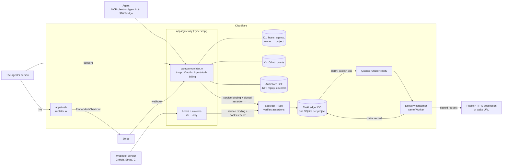

# RunLater — Architecture

Status: **current**, describes what runs in production · Owner: Patrick Thach · Last updated: 2026-11-04 · What it does: [PRODUCT.md](PRODUCT.md) · How it should feel: [DESIGN.md](DESIGN.md) · How to ship it: [DEPLOY.md](../DEPLOY.md)

## Decisions

| Decision | Choice |
| --- | --- |
| Primary customer | AI agents |
| Identity | Agent Auth (Better Auth `@better-auth/agent-auth`), plus MCP OAuth for the hosted `/mcp` server: a no-account consent page, one project per grant. No API keys. |
| Backend | Rust (`workers-rs`) on Cloudflare Workers: task ledger, scheduling, delivery |
| Agent-facing layer | TypeScript Worker: Agent Auth, hosted MCP, public hooks, billing |
| Frontend | Next.js on Cloudflare Workers via OpenNext, statically prerendered |
| Storage | One SQLite Durable Object per project; D1 only for identity and the owner-to-project map |
| Payments | Stripe Embedded Checkout for a person; MPP (`mppx`, Stripe Shared Payment Tokens) for an agent. Prepaid attempt packs, no accounts or subscriptions. |

## System



### `apps/gateway`: the only public entry for agents

| Path | Serves | Auth |
| --- | --- | --- |
| `/mcp` | Hosted MCP: Streamable HTTP, stateless, POST only. Tools are the capabilities. | OAuth 2.1 bearer token (`@cloudflare/workers-oauth-provider`) |
| `/authorize`, `/oauth/*` | Dynamic client registration, PKCE, the one-click consent page | `/authorize` and `/oauth/register` are rate limited per IP; `/oauth/token` isn't |
| `/.well-known/agent-configuration`, Agent Auth routes under its base path | Discovery, registration, capability execution | Agent Auth JWTs, single-use `jti` |
| `/h/{project}/{token}` | Inbound hooks. The only thing the hooks host serves. | The token, checked in the ledger |
| `/billing/webhook` | Stripe events | `Stripe-Signature` |
| `/billing/mpp/{link}` | An agent buying a pack | HMAC in the link, then the payment challenge |
| `/openapi.json`, `/llms.txt`, `/health` | Discovery documents; `/health` also checks the API | None |

- **Two identities, one path.** `runCapability` (`src/projects.ts`) takes an owner, either an Agent Auth host id or `mcp:<id>` from a grant, finds its project in `runlater_project`, and maps the capability to exactly one API call (`src/capabilities.ts`). The exception is `get_payment_link`, which the gateway answers itself. A project id is never taken from the caller.
- **The local bridge.** `@auth/agent-cli mcp --url <gateway>` is a stdio MCP server that holds an agent's keys and exposes generic tools (`execute_capability`, …). Nothing in the gateway is specific to it.
- **Rate limits** are Workers Rate Limiting bindings, alongside Better Auth's own limiter on the Agent Auth routes: registration 10/min per IP; OAuth registration and consent 20/min per IP and path; MPP 10/min; hooks 120/min per IP and 600/min per project. `/mcp` tool calls have none ([open question](PRODUCT.md#open-questions)).
- **Billing.** `get_payment_link` creates a Checkout Session and returns `runlater.io/pay#key=…&secret=…` and an `mpp_url`. Payments reach the ledger through `POST /v1/projects/self/credits` (scope `billing`), keyed by session or PaymentIntent id, so a retried webhook adds nothing. `payment_intent.succeeded` is the backstop if an MPP credit fails after the charge.

### `apps/api`: the task authority

Not on any public route (`workers_dev: false`, no custom domain). It is reached only through a service binding from the gateway.

- **Assertions.** Each request carries `RunLater-Assertion`: `{aud, sub: project_id, scope, iat, exp}` signed with Ed25519 by the gateway, living at most 5 minutes. The route table in `worker_entry.rs` names the scope each route needs. Scopes: `project`, `schedule`, `read`, `cancel`, `secrets`, plus two no agent is granted: `billing` and `hooks.receive`. A shared test vector pins the format across TypeScript and Rust.
- **The ledger.** `src/ledger.rs` is plain synchronous Rust behind a small `Db` trait, so the same code runs against rusqlite in `cargo test` and against Durable Object SQLite in workerd. A run of storage calls with no `await` between them commits atomically, and that is what makes "record the match and queue the action" one transaction.
- **Sealing.** `src/sealing.rs` holds AES-256-GCM with a per-project key derived by HKDF from `SECRETS_KEY`. The API seals before the ledger stores, so `ledger.rs` never holds plaintext. Two places open sealed values: the consumer at send time, and the Durable Object's entry code when it checks a hook's signature.
- **Glue.** `src/worker_entry.rs` is the HTTP entry, the `TaskLedger` class, its alarm and the queue consumer.

### `apps/web`

Landing page, docs (`/docs`, `/docs/capabilities`, `/docs/delivery`), `/pay`, `/terms`, `/privacy`. No auth and no server state. The capabilities page renders the same definitions the gateway serves.

### `apps/receiver`

A staging-only fixture: it records what the journey delivers and scripts replies (`ok`, `flaky`, `gone`). Never deployed to production.

## Where data lives

| Store | Holds | Notes |
| --- | --- | --- |
| `TaskLedger` DO, per project | `project`, `tasks`, `attempts`, `crons`, `payments`, `inbox`, `wake`, `secrets`, `hooks`, `hook_deliveries`, `meta` | The source of truth for budget, expiry and everything an agent scheduled |
| D1 `DB` | Better Auth tables, `runlater_project(host_id, project_id, created_at)` | `host_id` holds the owner, despite the name. Trial and budget are **not** here. |
| KV `OAUTH_KV` | OAuth clients, grants, tokens | Refresh tokens last 30 days from last use |
| `AuthStore` DO, one | JWT replay keys, Better Auth counters | One instance, so check-and-set is atomic |

Schema changes:

- **Ledger:** `MIGRATIONS` in `ledger.rs` is append-only (12 so far). Each ledger applies what it hasn't, when it opens, counted in `meta`.
- **D1:** `apps/gateway/migrations`, forward-only, applied at deploy before the gateway.

## How work moves

**Admission.** Before accepting work, the ledger refuses it if the project has expired (`403 trial_expired`), if the task cap would be exceeded (`429 task_limit`), or if waiting tasks plus the new one would need more attempts than are left (`402 budget_exhausted`). A waiting task reserves one attempt, plus one for a callback to a URL and any for its `on_match` action. This keeps storage bounded by what the project has paid for or been given.

**Delivery.** The task rows are the outbox; there is no separate table.

1. Scheduling writes the task and arms the DO's alarm for the earliest due time.
2. The alarm runs `recover` (expired leases), `purge`, `fire_crons` and `publish_due`, sends `{project_id, task_id, generation}` to the queue, and re-arms.
3. The consumer claims a fenced lease from the ledger, re-checks the destination, signs and sends (10 s timeout), and records the outcome.
4. A message lost on the way is harmless: a published task that nobody claimed becomes eligible again after 60 s. `generation` guards against stale dispatches and `fence` against stale results.

**Inbox and wake.** Writing an event happens in the transaction that finishes the task. If a wake is set, the same step queues a `wake_call` task, debounced, delivered like any other.

**Hooks.** The gateway applies its rate limits, reads at most 256 KiB and checks the project exists in D1, so a made-up id never creates a Durable Object. Then it forwards with a `hooks.receive` assertion. In the Durable Object, the entry code finds the hook by its token hash, opens the verify secret and checks the signature. The ledger then applies the rate limit, filter, dedupe and caps, and writes the event.

**Secrets at send time.** The ledger re-checks each reference and hands over sealed values; the consumer opens them, fills headers, sends, and redacts echoes before anything is stored.

## What must stay true

- A project id comes from the authenticated owner, never from the caller.
- The API has no public route, and every request carries a scoped assertion.
- Budget is charged inside the ledger, so no route can skip it.
- An accepted task always reaches `succeeded`, `failed` or `canceled`.
- Plaintext secrets never reach the ledger, a log, a view or an event.
- Destinations are checked when accepted and before every attempt, and `global_fetch_strictly_public` refuses private addresses after DNS resolution.
- Nothing a webhook sender wrote is echoed back to it.

## Internal API (gateway → api)

Source of truth: [`packages/contracts/openapi.yaml`](../../packages/contracts/openapi.yaml). It is written by hand, and nothing generates types from it or checks it against the routes.

```
POST   /v1/projects                    create (idempotent)
GET    /v1/projects/self
POST   /v1/projects/self/credits       scope: billing
POST   /v1/tasks                       schedule
GET    /v1/tasks?status=&lane=&cursor=&limit=
GET    /v1/tasks/{id}                  includes attempts
POST   /v1/tasks/{id}/cancel
POST   /v1/tasks/{id}/redrive
POST   /v1/watches
POST   /v1/crons
GET    /v1/crons
GET    /v1/crons/{name}
POST   /v1/crons/{name}/delete
POST   /v1/inbox/read
POST   /v1/inbox/ack
POST   /v1/wake
POST   /v1/wake/delete
POST   /v1/secrets                     scope: secrets
GET    /v1/secrets
POST   /v1/secrets/{name}/delete       scope: secrets
POST   /v1/hooks
GET    /v1/hooks
POST   /v1/hooks/_receive              scope: hooks.receive
POST   /v1/hooks/{name}                update, keeping the URL
POST   /v1/hooks/{name}/delete
GET    /health
```

## Repo layout

```
runlater/
├── apps/
│   ├── api/                 Rust Worker
│   │   ├── src/             worker_entry, ledger (+ ledger/hooks), assertion, sealing, db, http
│   │   └── test/            workerd e2e
│   ├── gateway/             TS Worker
│   │   ├── src/             index, mcp, consent, auth, store, projects, capabilities,
│   │   │                    api, hooks, billing, mpp, discovery, body
│   │   ├── migrations/      D1 SQL
│   │   └── e2e/             agent.e2e, journey, staging, oauth
│   ├── receiver/            TS Worker: staging fixture
│   └── web/                 Next.js + OpenNext: app/, components/, lib/
├── crates/
│   ├── core/                Pure domain: task state machine, retry, limits, request, cron,
│   │                        watch, wake, secret, hook. No Worker deps.
│   └── egress/              Pure: destination policy, header rules, request signing
├── packages/
│   ├── contracts/           capabilities.ts (shared by gateway and web), billing.ts, openapi.yaml
│   └── tsconfig/            shared TS config
├── plugins/runlater/        Claude Code plugin: MCP config and skill
├── .claude-plugin/          Plugin marketplace manifest
├── server.json              MCP Registry entry
├── scripts/                 setup-deploy-secrets.mjs
├── docs/
│   ├── DEPLOY.md
│   └── spec/                PRODUCT, ARCHITECTURE, DESIGN, and one note per larger feature
└── .github/workflows/       ci, deploy, deploy-env, monitor
```

## Adding a capability

1. Change the rules in `PRODUCT.md` first; `crates/core/src/limits.rs` follows it.
2. Define it in `packages/contracts/src/capabilities.ts`. That is what agents read and what the docs render.
3. Map it to one API call in `apps/gateway/src/capabilities.ts`, unless the gateway can answer it alone, as with `get_payment_link`.
4. Add the route and its scope in `worker_entry.rs`, the logic in the ledger, and any schema change as a new `MIGRATIONS` entry.
5. Add a D1 migration granting it to existing hosts. `test/host-capabilities.test.ts` fails until there is one.
6. Update `openapi.yaml`, the delivery docs and `lib/site.ts` (the web test checks the stated limits against `crates/core`), then the plugin's `SKILL.md` and `reference.md`, bumping its version in both manifests.
7. Follow the rules for agent-facing design in [DESIGN.md](DESIGN.md#designing-for-agents).

## Environments

One `wrangler.jsonc` per app with `env.staging` and `env.production` (the receiver has staging only). The Rust build has no Cargo feature flags of its own. Staging and production have separate D1, KV, queues and hostnames; see [DEPLOY.md](../DEPLOY.md).

## Testing

| Layer | Tool |
| --- | --- |
| `crates/*`, ledger | `cargo test`, native. The test database enforces workerd's limits (for example, `SQLITE_LIMIT_COMPOUND_SELECT = 5`). |
| `apps/api` | `npm run test:e2e`: the built Worker in local workerd, with DO SQLite, alarms and Queues |
| `apps/gateway` | `vitest` units; `npm run test:e2e`: gateway, API and receiver together, driven by the real `@auth/agent` SDK, the MCP bridge and scripted OAuth |
| Journey | `e2e/journey.mjs`: one agent's whole path, run locally in CI, on staging after each deploy, and daily against production |
| `apps/web` | `vitest`: the docs' Node and Python signature samples are executed against the `crates/egress` vector, and the stated limits are checked against `crates/core`. `npm run check` builds with OpenNext. There are no browser tests. |
| `apps/receiver` | `vitest` |

## CI/CD and monitoring

- **`ci.yml`** on every PR and on `main`: `cargo fmt`, `clippy` (native and wasm), `cargo test`; `typecheck`, `test`; then `wrangler deploy --dry-run` per Worker and both e2e suites.
- **`deploy.yml`** after CI passes on `main`, if `DEPLOY_ENABLED`: staging, then production behind the environment's required reviewer. Order within an environment: API, D1 migrations, gateway, web, receiver (staging only), health check, journey (staging only). A failed journey stops production.
- **`monitor.yml`**: health and the main site pages every 15 minutes, the journey against production daily. A failed run emails whoever last changed the workflow, and that is the only alert. Workers Logs are on for the API, gateway and web Workers.

## Risks

| Risk | Notes |
| --- | --- |
| Agent Auth maturity | Server packages are at 0.6.x and the bridge at 0.5.1, and the protocol may change. Hosted MCP doesn't depend on it, and it is kept to `src/auth.ts`, `store.ts` and the routes in `index.ts`. |
| Thin alerting | One GitHub email, from a workflow GitHub pauses after 60 days without repository activity. Nothing measures delivery lateness. |
| `AuthStore` is a single Durable Object | Every Agent Auth call goes through it for replay checks, so it is a throughput ceiling and a shared point of failure for that path. Hosted MCP doesn't use it. Fine at today's traffic; untested at scale. |
| `SECRETS_KEY` is never rotated | One per environment. Losing it loses every sealed secret and hook verify secret; leaking it exposes them if the ledgers leak too. |
| Contract drift | `openapi.yaml` isn't checked against the routes, so it can go stale without a test failing. |
| Concentration in `ledger.rs` | About 6,500 lines including tests, and every feature passes through it. Hooks have already moved to their own module; the others may follow. |

## History

The rebuild replaced an earlier implementation in seven phases: skeleton, core crates, API, gateway, web, e2e and deploy, cutover. Cutover finished on 2026-11-01: `runlater.io` and `gateway.runlater.io` serve these Workers, and the legacy hostnames, Workers, queues and `legacy/` tree are gone. The phase plan and the port-or-delete table are in this file's git history.
